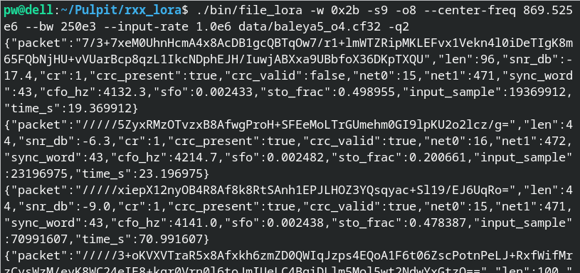
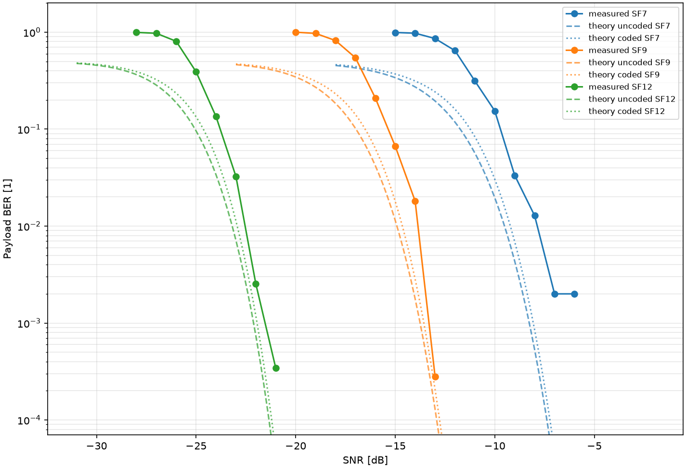

# rxx_lora

A plug-and-play RTL-SDR **[LoRa](https://lora-alliance.org/)** receiver in the spirit of
[`rtl_fm`](https://gitea.osmocom.org/sdr/rtl-sdr/src/branch/master/src/rtl_fm.c): 
USB dongle in, decoded packets out, no GNU Radio.


| Meshtastic packets from an I/Q capture file                                       |
| --------------------------------------------------------------------------------- |
|  |

> TODO: Gallery to be expanded

## Performance

End-to-end simulation under AWGN shows satisfactory results. 

For the physical layer (PHY) parameters used by [Meshtastic](https://meshtastic.org/docs/introduction/)'s **MediumFast** preset, the receive chain comes within **~1–2 dB** of theoretical performance at SNRs above -15 dB.

*Note on low SNRs:* Full packet loss is the dominant failure mode at low signal levels. In our simulation, a lost packet registers as 100% bit errors, where the theoretical curve  only reaches a 50% "coin-flip" error rate. 

| BER vs SNR under AWGN                                             |
| ----------------------------------------------------------------- |
|  |

Information regarding the used theoretical curves can be found under [docs/ber-theory](docs/ber-theory.md).

## Dependencies

The project aims to have minimal dependencies.
Naturally, the likes of `librtlsdr` are unavoidable if support for the actual device is to be present. Others are deliberate picks - FFT3 was added as testing revealed significant performance gains compared to a hand-rolled implementation.

### **C** (main project)

- normal OS: Linux, MacOS (probably)
- modern C compiler
- `make`
- [FFTW](https://www.fftw.org) v3 + headers:
  - Debian/Ubuntu: `libfftw3-dev`
  - Fedora: `fftw` `fftw-devel`
  - Arch: `fftw`
- [librtlsdr](https://gitea.osmocom.org/sdr/rtl-sdr) + headers:
  - Debian/Ubuntu: `librtlsdr0` `librtlsdr-dev`
  - Fedora: `rtl-sdr` `rtl-sdr-devel`
  - Arch: `rtl-sdr`

### **Python** (optional tools)

- Python 3.10 (or higher)
- `numpy` `matplotlib`

## Building, testing and running

```sh
# Full build (of both binaries)
make 

# Quick test (at least on typical hw) 
python3 tools/regression.py

# Help
file_lora -h
rtl_lora -h

# Processing a captured I/Q file -> JSONL file
file_lora -w 0 -s7 -o4 --center-freq 868e6 --bw 125e3 --input-rate 1.024e6 capture_o4.cf32 1>packets.jsonl

# RTL-SDR, Meshtastic MediumFast -> console
rtl_lora -w 0x2b -s9 -o8 --center-freq 869.525e6 --bw 125e3 --input-rate 1.024e6 capture_o4.cf32 -q2
```

## Credits

### Receive chain

The frame demodulation is nearly a word-for-word port of two GPL-licensed GNU Radio implementations, 
which makes this project a derivative work of both:

- **[gr-lora](https://github.com/rpp0/gr-lora)** - Pieter Robyns, Peter Quax,
  Wim Lamotte and William Thenaers
  ([Zenodo 10.5281/zenodo.853201](https://doi.org/10.5281/zenodo.853201));
  further contributors include Eduard Marin, Clayton Smith and
  Sébastien Dudek +
  [GitHub contributors](https://github.com/rpp0/gr-lora/graphs/contributors).
- **[gr-lora_sdr](https://github.com/tapparelj/gr-lora_sdr)** and the corresponding [paper](https://arxiv.org/abs/2002.08208) by Joachim
  Tapparel, Orion Afisiadis, Paul Mayoraz, Alexios Balatsoukas-Stimming and
  Andreas Burg, Telecommunication Circuits Laboratory, EPFL +
  [contributors](https://github.com/tapparelj/gr-lora_sdr/graphs/contributors).

Accordingly, the project is likewise released under the GNU GPL v3
(see [`LICENSE.md`](LICENSE.md)), and all credit for the original works goes to their authors and contributors.

It must be stated clearly that this project would have never gotten **anywhere** if the two above weren't already public.

While numerous patches and ideas have been applied on top of the originals, up to this day this project can be described as a but a repackaging of their block implementations.

### Resampling 

[liquid-dsp](https://liquidsdr.org/doc/) by *Joseph D. Gaeddert* was **historically** a dependency, providing arbitrary-ratio resampling. For performance reasons, it was "inlined", having some of its [sources](https://github.com/jgaeddert/liquid-dsp) scavenged for the resampler and supporting code, and re-packaged inside of this codebase instead. 

One way or the other, `liquid-dsp`'s code **is** used by this project. Credit is required and fully deserved, perhaps even more so when the dependency is no longer plainly visible as it would be with `-lliquid` present in the Makefile.

### Literature

> TODO: Full listing to be added

## Slop alert

Undoubetly, a quick exploration of the codebase or the longer docs will reveal heavy AI usage, with coding itself, but also theoretical exploration.

The project is how it is. Using it myself, I also want to release it quickly. Not all places are cleaned of slop, yet, although that is a goal in the near future.

As they say, `THE SOFTWARE IS PROVIDED "AS IS"`. 
You've been warned.