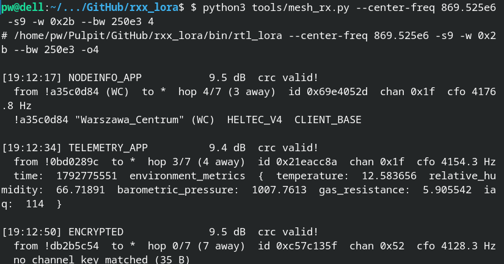

# rxx_lora

[](https://github.com/xdab/rxx_lora/actions/workflows/ci.yml)

A plug-and-play RTL-SDR **[LoRa](https://lora-alliance.org/)** receiver in the spirit of
[`rtl_fm`](https://gitea.osmocom.org/sdr/rtl-sdr/src/branch/master/src/rtl_fm.c):
USB dongle in, decoded packets out, no GNU Radio.

| Packets from an I/Q capture file                                   | Meshtastic frames from an RTL-SDR                                     |
| ------------------------------------------------------------------ | --------------------------------------------------------------------- |
|  |  |

## Dependencies

The project aims to have minimal dependencies.
Naturally, the likes of `librtlsdr` are unavoidable if support for the actual device is to be present. Others are deliberate picks - FFT3 was added as testing revealed significant performance gains compared to a hand-rolled implementation.

### **C** (main project)

- normal OS: Linux, MacOS (probably)
- modern C compiler
- `make`
- [FFTW](https://www.fftw.org) v3 + headers:
  - Debian/Ubuntu: `libfftw3-dev`
  - Fedora: `fftw` `fftw-devel`
  - Arch: `fftw`
- [librtlsdr](https://gitea.osmocom.org/sdr/rtl-sdr) + headers:
  - Debian/Ubuntu: `librtlsdr0` `librtlsdr-dev`
  - Fedora: `rtl-sdr` `rtl-sdr-devel`
  - Arch: `rtl-sdr`
- (Optional) `clang-format` formatter:
  - Debian/Ubuntu: `clang-format`
  - Fedora: `clang-tools-extra`
  - Arch: `clang`
- (Optional) `clang-tidy` static analyzer (`make tidy`):
  - Debian/Ubuntu: `clang-tidy`
  - Fedora: `clang-tools-extra`
  - Arch: `clang`

### **Python** (optional, helper tools)

- Python 3.10 (or higher)
- `numpy` `matplotlib`
- (Optional) `ruff` linter and formatter
- (Optional) the [Meshtastic](https://pypi.org/project/meshtastic/) library; for `tools/mesh_rx.py`

## Building, testing and running

```sh
# The usual make targets
make 
sudo make install

# Quick tests
python3 tools/regression.py
python3 tools/regression_perf.py

# Help
make help
file_lora -h
rtl_lora -h

# Processing a captured I/Q file -> JSONL file
file_lora -w 0 -s7 -o4 --center-freq 868e6 --bw 125e3 --input-rate 1.024e6 capture_o4.cf32 1>packets.jsonl

# RTL-SDR, Meshtastic MediumFast -> console
rtl_lora -w 0x2b -s9 -o8 --center-freq 869.525e6 --bw 125e3 --input-rate 1.024e6 capture_o4.cf32 -q2

# Python tool using rtl_lora, decoding Meshtastic frames 
python3 tools/mesh_rx.py --center-freq 869.525e6 -s9 -w 0x2b --bw 250e3 4
```

## Performance

End-to-end simulation under AWGN shows satisfactory results.

For the physical layer (PHY) parameters used by [Meshtastic](https://meshtastic.org/docs/introduction/)'s **MediumFast** preset, the receive chain comes within **~1–2 dB** of theoretical performance at SNRs above -15 dB.

| BER vs SNR under AWGN                                             |
| ----------------------------------------------------------------- |
|  |

Information regarding the used theoretical curves can be found under [docs/ber-theory](docs/ber-theory.md).

## Credits

### Receive chain

The frame demodulation is nearly a word-for-word port of two GPL-licensed GNU Radio implementations,
which makes this project a derivative work of both:

- **[gr-lora](https://github.com/rpp0/gr-lora)** - Pieter Robyns, Peter Quax,
  Wim Lamotte and William Thenaers
  ([Zenodo 10.5281/zenodo.853201](https://doi.org/10.5281/zenodo.853201));
  further contributors include Eduard Marin, Clayton Smith and
  Sébastien Dudek +
  [GitHub contributors](https://github.com/rpp0/gr-lora/graphs/contributors).
- **[gr-lora_sdr](https://github.com/tapparelj/gr-lora_sdr)** and the corresponding [paper](https://arxiv.org/abs/2002.08208) by Joachim
  Tapparel, Orion Afisiadis, Paul Mayoraz, Alexios Balatsoukas-Stimming and
  Andreas Burg, Telecommunication Circuits Laboratory, EPFL +
  [contributors](https://github.com/tapparelj/gr-lora_sdr/graphs/contributors).

Accordingly, the project is likewise released under the GNU GPL v3
(see [`LICENSE.md`](LICENSE.md)), and all credit for the original works goes to their authors and contributors.

It must be stated clearly that this project would have never gotten **anywhere** if the two above weren't already public.

While numerous patches and ideas have been applied on top of the originals, up to this day this project can be described as a but a repackaging of their block implementations.

### Resampling

[liquid-dsp](https://liquidsdr.org/doc/) by _Joseph D. Gaeddert_ was **historically** a dependency, providing arbitrary-ratio resampling. For performance reasons, it was "inlined", having some of its [sources](https://github.com/jgaeddert/liquid-dsp) scavenged for the resampler and supporting code, and re-packaged inside of this codebase instead.

One way or the other, `liquid-dsp`'s code **is** used by this project. Credit is required and fully deserved, perhaps even more so when the dependency is no longer plainly visible as it would be with `-lliquid` present in the Makefile.

### Literature

- J. Tapparel, O. Afisiadis, P. Mayoraz, A. Balatsoukas-Stimming, A. Burg, _An Open-Source LoRa Physical Layer Prototype on GNU Radio_ — [arXiv:2002.08208](https://arxiv.org/abs/2002.08208); the paper behind gr-lora_sdr.
- M. Knight, B. Seeber, _Decoding LoRa: Realizing a Modern LPWAN with SDR_ — [pubs.gnuradio.org](https://pubs.gnuradio.org/index.php/grcon/article/view/8); the canonical dechirp+argmax demodulation and preamble,SFD,payload sync sequence behind gr-lora above.
- C. Bernier, F. Dehmas, N. Deparis, _Low Complexity LoRa Frame Synchronization for Ultra-Low Power Software-Defined Radios_ — [hal.science](https://cea.hal.science/cea-02280910); the fractional-CFO estimator implemented in `src/sync.c`.
- M. Xhonneux, O. Afisiadis, D. Bol, J. Louveaux, _A Low-Complexity LoRa Synchronization Algorithm Robust to Sampling Time Offsets_ — [arXiv:1912.11344](https://arxiv.org/abs/1912.11344); the CFO/STO estimator decomposition and  correction ordering; dechirp-LO convention cited in `tools/common.py`.
- L. Vangelista, _Frequency Shift Chirp Modulation: the LoRa Modulation_ — [doi:10.1109/LSP.2017.2762960](https://doi.org/10.1109/LSP.2017.2762960); the mathematical ground truth for the chirp kernels in `tools/common.py`; the orthogonality argument behind dechirp+FFT demodulation.
- M. Chiani, A. Elzanaty, _On the LoRa Modulation for IoT: Waveform Properties and Spectral Analysis_ — [arXiv:1906.04256](https://arxiv.org/abs/1906.04256); the phase-continuous chirp model (the k²/2 term) used in `tools/common.py`.
- Classy Code, _LoRa Sync Word Compatibility between SX127x and SX126x_ — [blog.classycode.com](https://blog.classycode.com/lora-sync-word-compatibility-between-sx127x-and-sx126x-460324d1787a); why `src/sync.c` matches sync words modulo nibbles the way it does.
- A. Marquet, N. Montavont, G. Z. Papadopoulos, _Towards an SDR Implementation of LoRa: Reverse-engineering, Demodulation Strategies and Assessment over Rayleigh Channel_ — [doi:10.1016/j.comcom.2020.02.034](https://doi.org/10.1016/j.comcom.2020.02.034); demodulation-strategy tradeoffs,  deinterleave-before-dewhitening ordering.
- R. Ghanaatian, O. Afisiadis, M. Cotting, A. Burg, _LoRa Digital Receiver Analysis and Implementation_ — [arXiv:1811.04146](https://arxiv.org/abs/1811.04146); the half-a-bin CFO tolerance — the standing check for "is this correction good enough".
- O. Afisiadis, S. Li, A. Burg, A. Balatsoukas-Stimming, _On the Advantage of Coherent LoRa Detection in the Presence of Interference_ —  [arXiv:2010.00507](https://arxiv.org/abs/2010.00507); grounds the decision to stay with hard, non-coherent demodulation.
- T. Elshabrawy, J. Robert, _Closed-Form Approximation of LoRa Modulation BER Performance_ — [doi:10.1109/LCOMM.2018.2849718](https://doi.org/10.1109/LCOMM.2018.2849718); the closed-form AWGN SER behind the `--theory` curves in `tools/ber.py`.
- O. Afisiadis, M. Cotting, A. Burg, A. Balatsoukas-Stimming, _On the Error Rate of the LoRa Modulation with Interference_ — [arXiv:1905.11252](https://arxiv.org/abs/1905.11252); the same SER as eq. (18), which is what `tools/ber.py` implements; detector false-alarm framing in `tools/c_fa.py`.
- O. Afisiadis, A. Burg, A. Balatsoukas-Stimming, _Coded LoRa Frame Error Rate Analysis_ — [arXiv:1911.10245](https://arxiv.org/abs/1911.10245); the iid-after-deinterleaving assumption behind the coded BER model.
- Wireless Pi, _Understanding LoRa PHY (Long-Range Physical Layer)_ — [wirelesspi.com](https://wirelesspi.com/understanding-lora-phy-long-range-physical-layer).

## Slop alert

Undoubetly, a quick exploration of the codebase or the longer docs will reveal heavy AI usage, with coding itself, but also theoretical exploration.

The project is how it is. Using it myself, I also want to release it quickly. Not all places are cleaned of slop, yet, although that is a goal in the near future.

As they say, `THE SOFTWARE IS PROVIDED "AS IS"`.
You've been warned.
